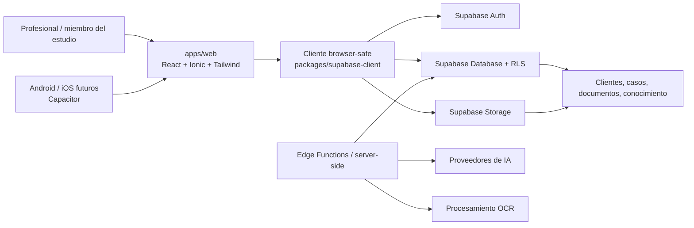

# Contexto del sistema

- Estado: línea base propuesta
- Última actualización: 2026-08-02

## Propósito

Definir los actores y límites principales de CasePilot antes de diseñar tablas, APIs o componentes concretos.

## Contexto lógico

El diagrama representa una dirección de diseño, no todos los componentes están implementados. Los futuros clientes móviles deben consumir la misma lógica de dominio y contratos; no deben copiar las reglas dentro de la capa nativa.

## Actores externos

| Actor | Relación | Consideración |
| --- | --- | --- |
| Profesional | Usuario principal | Maneja clientes, casos y documentos propios o del espacio activo. |
| Colaborador | Usuario invitado | Accede según su membresía y rol. |
| Cliente final | Actor futuro | Podrá recibir comunicaciones o documentos si se habilita un portal. |
| Supabase Auth | Servicio de identidad | Emite y verifica sesiones; la aplicación no debe replicar credenciales. |
| Proveedor de IA | Servicio de procesamiento | Recibe únicamente el contexto autorizado y bajo políticas de privacidad. |
| Proveedor OCR | Servicio de extracción | Procesa archivos autorizados y debe devolver estados y errores trazables. |

## Límites iniciales

- La UI orquesta flujos; no contiene acceso directo a base de datos ni decisiones de autorización.
- `packages/domain-models` contendrá reglas puras cuando exista el primer caso de uso compartido.
- `packages/supabase-client` será la frontera browser-safe para queries, comandos, tipos y mapeadores.
- `packages/supabase-admin` y las Edge Functions serán server-side y nunca llegarán al bundle web.
- `packages/platform` aislará archivos, biometría, notificaciones y otras capacidades web/native cuando se incorporen.
- El tenant activo es una selección de contexto, no una prueba de permiso. El backend debe validar membresía y rol.

## Documentos relacionados

- [Línea base de arquitectura](architecture-baseline.md)
- [ADR 0001 — Autenticación y aislamiento multi-tenant](../06-decisions/0001-autenticacion-y-aislamiento-multi-tenant.md)
- [Instrucciones de arquitectura](../../.agents/instructions/10-architecture.md)
