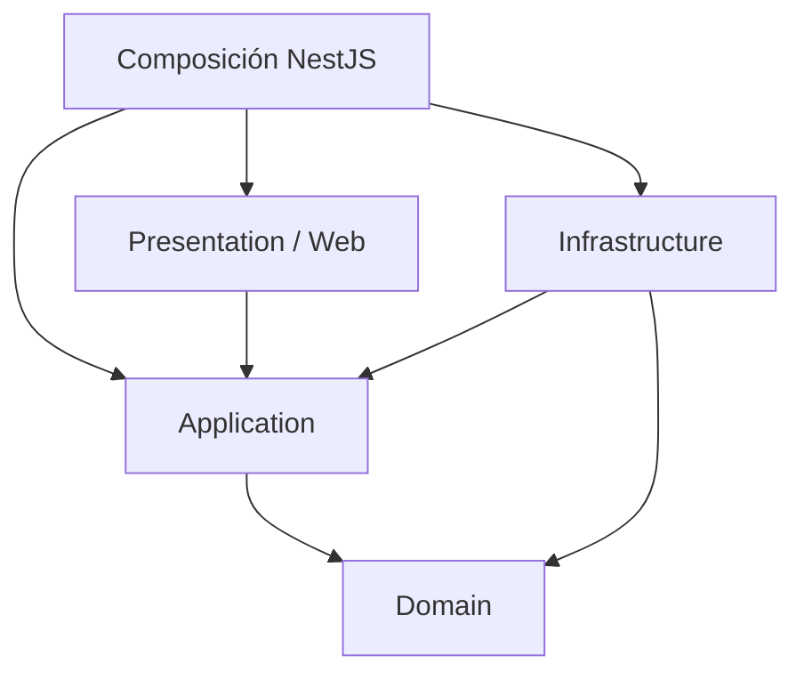

# Arquitectura base backend — NestJS, TypeORM y negocio en Application

- Estado: base reutilizable, disponible para adopción explícita por distintos productos y proyectos.
- Fecha inicial: 2026-09-30.
- Revisión: 2026-10-02.
- Alcance: backend NestJS/TypeScript con TypeORM; independiente del nombre, rutas y despliegue de un producto.
- Reglas normativas: [Reglas obligatorias de la arquitectura base backend](backend-architecture-baseline-rules.md).

## 1. Propósito y adopción

Esta base describe una arquitectura concreta y reutilizable. No pretende imponer una única arquitectura a todo backend ni adoptar automáticamente proyectos por estar en el mismo repositorio. Cada proyecto registra su adopción en un ADR y mantiene un documento de arquitectura particular que enlaza esta guía y el catálogo completo de reglas.

La arquitectura particular define la aplicación propietaria, transportes, proveedores, entornos, estrategia de despliegue y verificaciones implementadas. Puede añadir restricciones compatibles; no admite excepciones locales a las reglas adoptadas. Un cambio incompatible requiere una decisión explícita y actualización coordinada de la normativa antes de implementarlo.

El backend comienza como una aplicación desplegable con un dominio compartido y cuatro capas para todo el proyecto: Application, Domain, Infrastructure y Presentation. No se divide por bounded contexts. NestJS resuelve el transporte y la composición; TypeORM implementa el acceso a persistencia.

La decisión central de este backend es que **toda lógica de negocio y de casos de uso reside exclusivamente en Application**, dentro de commands, queries y sus colaboradores internos. Domain contiene modelos y contratos sin comportamiento de negocio. Esta es una elección explícita de esta base: no se adopta un dominio con entidades que ejecutan reglas, transiciones o validaciones de negocio.

El documento de reglas es la fuente normativa. Este documento explica responsabilidades, flujos y alternativas compatibles; los ejemplos ilustran la arquitectura y no constituyen requisitos funcionales de un producto concreto.

## 2. Organización por aplicación y por capa

La aplicación/proyecto es la unidad propietaria del dominio. Las cuatro capas se declaran una sola vez directamente bajo su raíz de fuentes, sin `contexts/` ni capas repetidas por feature. Productos, órdenes, categorías, usuarios y customers de un ecommerce hipotético pueden convivir y relacionarse en la misma capa Domain. Las subcarpetas de cada capa sirven para ordenar su contenido, sin exigir APIs públicas o modelos duplicados por entidad.

| Área | Responsabilidad | Contenido típico |
| --- | --- | --- |
| Domain | Representación de datos y contratos internos de la aplicación | Entidades sin comportamiento, tipos, enums, constantes, estructuras de valores y contratos de repositorios. |
| Application | Todas las decisiones de negocio y la ejecución de casos de uso | Commands, queries, handlers, request/response models, políticas, validadores de negocio, mappers de aplicación y puertos de integración/transacciones. |
| Infrastructure | Implementación de mecanismos técnicos | Configuración, conexión/DataSource/migraciones en `database/`, repositorios TypeORM, consultas individuales, modelos/esquemas ORM, mappers de persistencia y adaptadores externos. |
| Presentation/Web | Adaptación de transporte | Controllers, DTOs HTTP, pipes, guards técnicos, interceptors, filtros, consumidores de mensajes y adaptación de errores. |
| Composición | Construcción y configuración del proceso | Bootstrap, módulos NestJS, registro de providers, bindings de puertos, configuración validada y health checks. |

`Data` es la especialización de persistencia de Infrastructure. No hace falta una quinta capa de negocio para distinguir base de datos, correo, almacenamiento o mensajería: son mecanismos con adaptadores diferentes dentro de Infrastructure.

### Organización conceptual del código backend

Los nombres de operaciones son ilustrativos. Cada proyecto define su ubicación en la estructura de su repositorio y crea directorios cuando exista contenido real:

```text
src/
├── main.ts / app.module.ts
├── application/
│   ├── orders/
│   │   ├── create-order.command.ts
│   │   ├── create-order.request.ts
│   │   ├── create-order.response.ts
│   │   └── get-order/             # agrupación opcional por operación
│   │       ├── get-order.query.ts
│   │       ├── get-order.request.ts
│   │       └── get-order.response.ts
│   ├── users/
│   └── ports/
├── domain/
│   ├── entities/
│   └── repositories/
├── infrastructure/
│   ├── config/
│   ├── database/
│   │   ├── data-source.ts
│   │   └── migrations/
│   └── persistence/
│       ├── schemas/
│       ├── repositories/
│       └── mappers/
└── presentation/
```

Esta organización describe responsabilidades internas. Las carpetas globales del repositorio, la raíz de cada paquete y la ubicación física de sus pruebas pertenecen a la documentación de estructura del repositorio adoptante.

El ejemplo agrupa Application por recurso. Commands y queries conservan sus contratos y diferencias de comportamiento dentro de cada recurso. La obligatoriedad de esta convención en CasePilot API se define en [CPA-001 de su arquitectura particular](casepilot-backend-architecture.md#cpa-001--application-de-la-api-organizada-por-recurso); BCK-014 permite organizar subcarpetas sin repetir capas.

## 3. Dependencias y composición con NestJS

Las flechas siguientes representan dependencias de código, no el orden temporal de ejecución:



Domain no importa Application, Infrastructure ni Presentation. Application importa modelos de Domain y consume puertos propios; no importa sus implementaciones. Infrastructure implementa contratos de repositorios de Domain y puertos de Application. Presentation invoca casos de uso de Application.

El código de negocio de Application y los modelos de Domain no dependen de NestJS, TypeORM, HTTP, SDKs de proveedores o APIs del proceso. Los adaptadores y la composición resuelven esas dependencias. Los puertos necesarios para reloj, identificadores o servicios externos se incorporan cuando un caso de uso los requiera.

El módulo raíz NestJS compone los handlers, controllers y adaptadores de la aplicación. Las capas conceptuales no requieren un `DomainModule`, `ApplicationModule` o `DataModule` global ni un provider por entidad. Se separan submódulos técnicos únicamente cuando exista una responsabilidad real; esos bindings no crean bounded contexts ni capas paralelas por feature.

Un proyecto puede ubicar los módulos de composición por recurso junto a sus adaptadores de entrada dentro de Presentation, conservando su responsabilidad de composición. Esos archivos enlazan contratos e implementaciones; sus controllers siguen delegando a Application sin importar persistencia ni composición. CasePilot concreta ubicación y fronteras en [CPA-004](casepilot-backend-architecture.md#cpa-004--presentation-organizada-por-modulo-de-recurso), sin modificar el catálogo BCK.

Las interfaces TypeScript necesitan un token de runtime para su resolución por Nest, o una clase abstracta usada como contrato. El binding token/implementación se realiza en composición, sin añadir decoradores del contenedor al núcleo de negocio. [Providers y tokens de NestJS](https://docs.nestjs.com/fundamentals/custom-providers).

## 4. Domain: modelos sin lógica de negocio

Domain define los datos y contratos compartidos por la aplicación: identificadores, propiedades de entidades, relaciones, enums, constantes y firmas de repositorios. Puede representar una agrupación de entidades relacionada conceptualmente; esa agrupación no autoriza métodos de negocio ni escrituras compuestas en un repositorio.

Los constructores pueden asignar propiedades. No validan elegibilidad, permisos, importes, estados, fechas de negocio ni transiciones. Tampoco publican eventos, consultan datos o ejecutan integraciones. Si se usan estructuras de valores, siguen la misma restricción; un value object no es un lugar alternativo para esconder una regla.

Por ejemplo, Domain puede declarar `WorkItemStatus` y la propiedad `status` de `WorkItem`. La decisión de si un elemento puede completarse y la asignación del nuevo estado pertenecen al command de Application. No se define `workItem.complete()` con reglas de negocio en Domain.

Los contratos de repositorios aquí describen entrada/salida de entidades y sus relaciones explícitas, con tipos independientes del ORM. No contienen implementación, SQL ni modelos HTTP.

## 5. Application: commands, queries y modelos obligatorios

Cada operación de negocio tiene un handler responsable y dos clases concretas: `<Operation>Request` y `<Operation>Response`. La firma de ejecución tiene exactamente un parámetro requerido y devuelve exactamente un objeto response:

```typescript
execute(request: CompleteWorkItemRequest): Promise<CompleteWorkItemResponse>
execute(request: GetWorkItemRequest): Promise<GetWorkItemResponse>
```

Estas firmas son ilustrativas. Las dependencias se reciben por construcción/inyección; no se agregan como parámetros de ejecución. El request contiene todos los inputs de la operación, incluidos identidad autenticada, ámbito autorizado o metadatos necesarios. No se propaga un `Request` HTTP, un `EntityManager` o un contexto NestJS como propiedad.

Incluso una operación con un único identificador recibe su clase request. Una operación sin datos específicos recibe una clase request sin campos específicos; el argumento sigue siendo obligatorio. No se permiten parámetros primitivos sueltos, argumentos adicionales, parámetros opcionales, rest parameters o sobrecargas que eludan este contrato.

El response contiene todos los datos de salida. Un borrado puede devolver el identificador afectado y su resultado; una búsqueda puede devolver `{ found, item }`; un listado devuelve un objeto con `items` y la información de paginación requerida. La ausencia de datos se representa dentro del response, nunca mediante `void`, `undefined`, `null` o un array como retorno completo. Los errores se propagan como errores tipados y no se convierten en respuestas de éxito vacías.

Los modelos de request/response definen estructura. Las validaciones, decisiones y cálculos residen en el handler o en colaboradores de Application invocados por él. Las políticas y validadores compartidos dentro de Application no son puntos de entrada alternativos que los controllers o repositorios puedan invocar para ejecutar negocio.

### Commands y queries

Un command representa una intención que modifica estado; puede leer para tomar decisiones. Una query obtiene información y construye un response sin modificar estado de negocio ni disparar commands. Ambos usan el mismo contrato obligatorio de request/response.

La separación CQRS comienza con la misma base de datos. No obliga a adoptar event sourcing, bases separadas o un broker. `@nestjs/cqrs` es una opción de despacho, no una dependencia obligatoria del núcleo. [CQRS en NestJS](https://docs.nestjs.com/recipes/cqrs).

Los handlers pueden implementar un contrato genérico puro y ejecutarse mediante invocación directa. Una librería técnica de contratos puede definir bases Request/Response y una firma Handler común; los modelos concretos y el negocio permanecen en Application de su proyecto. Las bases solo aportan estructura y tipos, sin validación ni comportamiento funcional. El mismo Handler puede ejecutar commands y queries; la ausencia de mutaciones se acredita revisando su comportamiento. CasePilot adopta `@casepilot/cqrs` e invocación directa conforme a [CPA-002](casepilot-backend-architecture.md#cpa-002--contratos-cqrs-compartidos-e-invocacion-directa) y al [ADR 0010](../adr/0010-shared-cqrs-contracts.md); esa elección no amplía las obligaciones de la base reutilizable.

Si se usa el bus de Nest, sus mensajes y handlers adaptadores se resuelven en la frontera de composición/transporte. El adaptador delega al handler de Application con su único request. Un mensaje command/query envoltorio recibe únicamente ese request; no incorpora inputs paralelos. La API de Nest no modifica la firma del caso de uso ni introduce negocio en el adaptador.

### Mapeos y validación

```text
HTTP DTO + identidad verificada
  -> Application Request
  -> Handler
  -> Application Response
  -> HTTP Response DTO
```

Presentation verifica forma, tipos y límites técnicos del protocolo. Application valida reglas del producto, permisos sobre recursos, elegibilidad y coherencia de inputs. Esa validación se ejecuta también al invocar el handler desde un worker o scheduler.

Application selecciona explícitamente los campos que crea o modifica en las entidades y los campos que devuelve en el response. No copia masivamente un body sobre una entidad. Infrastructure transforma representación de datos sin elegir estados, calcular valores del producto o aplicar políticas. Presentation transforma representación HTTP sin completar decisiones de negocio.

## 6. Presentation/Web: adaptadores de entrada

Los controllers reciben el input, obtienen identidad previamente verificada, construyen el request, invocan un único caso de uso y adaptan su response/errores al protocolo. Un flujo que requiere varios commands o queries se compone en Application, no en el controller.

Guards, pipes y middlewares pueden resolver autenticación técnica, formato, tamaño de payload, correlación, CORS o rate limits. La autorización sobre un caso, una transición o un ámbito de datos es lógica del producto y pertenece a Application. Un guard no sustituye esa autorización.

Presentation no inyecta repositorios, `DataSource`, `EntityManager` ni SDKs externos para atender operaciones de negocio. Consumidores de colas, webhooks y schedulers siguen la misma frontera: adaptan un input al request y delegan al caso de uso. Endpoints técnicos como health checks pertenecen a la operación del proceso y no se usan para ejecutar negocio.

Los contratos externos pueden evolucionar por consumidor o versión sin exponer entidades internas. Sus esquemas se mantienen en el área de contratos definida por el proyecto; los DTOs y decoradores específicos de Nest permanecen en el adaptador propietario.

## 7. Infrastructure/Data y repositorios TypeORM

TypeORM ya ofrece `Repository<T>`, `EntityManager` y APIs de consulta/persistencia. Un repositorio propio implementa un contrato interno del dominio y compone el repositorio TypeORM, sin copiar opciones del ORM. BCK-021 acota sus firmas a primitivos, entidades con contrato explícito y modelos de data access compartidos. Un contrato CRUD genérico puro puede uniformar esas operaciones sin implementar negocio ni persistencia universal. La integración Nest registra recursos en Infrastructure/composición. CasePilot adopta las abstracciones del [ADR 0011](../adr/0011-data-access-abstractions.md). [Integración NestJS–TypeORM](https://docs.nestjs.com/data/typeorm).

| Pieza | Ubicación |
| --- | --- |
| Contrato de entrada/salida de una entidad | `domain/repositories/` de la aplicación. |
| Implementación TypeORM | `infrastructure/persistence/repositories/` de la aplicación. |
| Configuración de tablas, columnas, relaciones e índices | `infrastructure/persistence/schemas/` o modelos ORM de la aplicación. |
| Mapper modelo persistido/modelo interno | `infrastructure/persistence/mappers/` de la aplicación. |
| Puerto de lectura especializado, si aporta una frontera real | `application/ports/`; su implementación técnica permanece en Infrastructure. |
| Conexión, DataSource CLI, opciones y migraciones de la API | `infrastructure/database/` del proyecto propietario. |

### Una operación individual por método

Los repositorios funcionan exclusivamente como entrada/salida de la entidad que manejan y de sus relaciones declaradas. Sus métodos representan operaciones individuales: obtener, agregar, actualizar o eliminar. Un método de lectura puede obtener una colección o una proyección estructural de esa entidad y sus relaciones; no decide la elegibilidad de negocio de los datos.

Ejemplos conceptuales válidos son `getById`, `getPage`, `add`, `update` y `delete`. Los filtros y el ámbito permitido los decide Application; el repositorio los traduce a una consulta parametrizada. Un update puede devolver metadatos técnicos de la escritura, como filas afectadas, para que Application interprete el resultado.

Si una página necesita una lectura de items y otra del total, la query de Application coordina ambas operaciones individuales. El hecho de que TypeORM ofrezca una API compuesta como `findAndCount` no autoriza esconderlas dentro de un método de repositorio. Una proyección que obtiene datos y metadatos en una única operación de lectura sigue siendo válida.

Son inválidos métodos como `completeWorkItemAndNotify`, `createWorkItemWithHistory` o `updateIfBusinessAllows`. También lo son leer, decidir y escribir dentro de un único método; invocar otro repositorio; publicar mensajes; guardar varias entidades mediante cascadas; o iniciar una transacción.

La atomicidad corresponde a la operación individual de persistencia. No se deduce del nombre del método ni de haber escrito una sola llamada al ORM. Un driver puede emitir SQL auxiliar para materializar una lectura; eso no autoriza componer varias acciones, escribir otras entidades o esconder transacciones. Si hay varias escrituras necesarias, Application las expresa y coordina explícitamente.

### Relaciones, lecturas y proyecciones

Una lectura puede usar joins de relaciones propias y seleccionar únicamente los campos necesarios. La carga es explícita y se materializa antes de salir de Infrastructure; no se exponen relaciones lazy que produzcan I/O al construir un response.

La escritura de una entidad relacionada o de una asociación persistida separada requiere su operación explícita. Un repositorio no persiste automáticamente un grafo completo. Application coordina las operaciones individuales y solicita una transacción cuando deben completarse conjuntamente.

Las consultas de dashboards que combinan entidades o varias fuentes se orquestan en una query de Application usando contratos internos y lecturas individuales. Dentro de la aplicación pueden usarse joins de relaciones explícitas de su dominio; fuentes de otras aplicaciones se consumen por APIs/contratos públicos. Un adaptador de lectura no constituye una excepción: obtiene datos, sin políticas, cálculos de negocio ni múltiples operaciones ocultas.

### Modelos ORM y configuración

Se puede mapear un modelo de Domain mediante un `EntitySchema` externo, o mantener un modelo ORM separado con un mapper estructural. Se elige según la diferencia real entre representaciones; en ambos casos TypeORM permanece fuera de Domain y Application. [Definición externa de entidades](https://typeorm.io/docs/entity/separating-entity-definition/).

Los contratos no exponen `Repository<T>`, `FindOptions`, `QueryBuilder`, `EntityManager`, `QueryRunner` ni modelos del driver. No se introduce un `BaseRepository<T>` que copie la superficie del ORM o permita eludir la frontera.

Los contratos Entity y los modelos PageRequest/PageResponse tienen identidad compartida; un DTO o un objeto de igual forma no los sustituye. Las colecciones y Promise envuelven únicamente tipos permitidos. Los parámetros genéricos mantienen esas restricciones. La validación de límites numéricos y el cálculo de offset/totalPages son mecanismos técnicos, sin reglas del producto. BCK-021 delimita las firmas completas, sin impedir propiedades/relaciones estructurales de las entidades.

Las escrituras usan mecanismos que mantengan explícita la operación. `save`/`remove` no se aceptan por defecto como garantía de esa propiedad: pueden activar transacciones y comportamiento auxiliar. Cuando su uso sea compatible, se deshabilita la creación automática de transacciones y se verifica que no exista lectura/escritura compuesta ni cascadas. Se evalúan operaciones explícitas como `insert`, `update` y `delete` para la intención correspondiente. [API de repositorios TypeORM](https://typeorm.io/docs/working-with-entity-manager/repository-api/).

No se habilitan cascadas de escritura, eliminación de huérfanos, cascadas de borrado en la base o listeners/subscribers/triggers que ejecuten operaciones adicionales de producto. PK, FK, UNIQUE y NOT NULL protegen integridad estructural y concurrencia; no son una ubicación para programar casos de uso. [Relaciones y cascadas TypeORM](https://typeorm.io/docs/relations/relations/).

## 8. Transacciones y concurrencia

Application es dueño del alcance transaccional: decide qué operaciones deben completarse juntas, su orden y el tratamiento de fallos. La política no vive en un repositorio.

Se distingue esa responsabilidad del mecanismo del driver. Un puerto de ejecución transaccional de Application puede tener un adaptador técnico en Infrastructure que abra, confirme, revierta y libere la conexión según el resultado del callback. El adaptador no selecciona operaciones ni toma decisiones del producto. El cuerpo del callback pertenece a Application y recibe un scope con puertos/repositorios vinculados a esa transacción.

BCK-022 concreta este puerto como UnitOfWork compartido, con un conjunto tipado de repositorios y callback de Application. Su implementación crea bindings nuevos por ejecución; los repositorios solo reciben el manager en Infrastructure. El resultado se entrega tras el commit; rollback y liberación se verifican con la base real. No se usan repositorios globales/capturados, no se conserva el scope y no se anidan Unit of Work. El aislamiento se solicita mediante un valor primitivo independiente del ORM. CasePilot implementa el adaptador técnico en la entrada separada `/typeorm` de su librería de abstracciones; el núcleo solo consume contratos puros.

```text
Command handler de Application
  -> solicita ejecución transaccional
  -> recibe repositorios del scope
  -> obtiene los datos necesarios
  -> verifica reglas y permisos en Application
  -> ejecuta cada escritura individual
  -> construye el response
  -> devuelve el response solo tras completar el commit
```

Todas las operaciones del scope usan el manager transaccional proporcionado por TypeORM. Un repositorio inyectado globalmente no participa automáticamente de una transacción. Tampoco se modifica un singleton para guardar temporalmente el manager de una petición: cada ejecución mantiene un scope aislado. [Transacciones TypeORM](https://typeorm.io/docs/transactions/).

Un repositorio no llama `transaction`, `startTransaction`, `commitTransaction` o `rollbackTransaction`, ni activa una transacción propia implícita del ORM. Puede participar de la transacción que recibió del scope. La transacción implícita con que el motor ejecuta una sentencia atómica no es una transacción compuesta creada por el repositorio.

Las decisiones de concurrencia pertenecen a Application. Una lectura seguida de una escritura requiere analizar conflictos concurrentes; se elige aislamiento, bloqueo o actualización condicional/versionada según el caso. Infrastructure ejecuta el mecanismo y devuelve datos o errores técnicos; Application determina si el resultado es conflicto, reintento permitido u otro resultado del caso de uso. Una transacción por sí sola no resuelve cualquier carrera.

Las llamadas a correo, storage o sistemas externos no se consideran revertidas por el rollback SQL. Application define cuándo ejecutarlas y cómo tratar sus fallos. Si aparece un requisito real de entrega fiable junto con una escritura, se diseña outbox e idempotencia: Application registra explícitamente el mensaje y la entidad en su transacción, sin delegarlo a un hook del repositorio.

## 9. Migraciones, scripts y configuración

Cada tabla y configuración ORM tiene una aplicación/proyecto propietario. Su `infrastructure/database/` contiene la conexión, DataSource, opciones y secuencia coordinada de migraciones por base de datos. Varias APIs no mantienen historiales independientes que compitan sobre las mismas tablas.

La configuración de runtime y la del CLI de migraciones se construyen con la misma fuente de entidades/opciones. `autoLoadEntities` de Nest no sustituye el registro explícito del `DataSource` que usa el CLI fuera del proceso Nest. La definición contiene nombres de variables y referencias seguras; las credenciales se inyectan en backend.

Los entornos gestionados usan migraciones versionadas y `synchronize: false`. Su ejecución se coordina en un paso de release autorizado; no se dispara desde cada réplica de API al atender requests. Las migraciones generadas se revisan antes de ejecutarse. [Migraciones TypeORM](https://typeorm.io/docs/migrations/why/).

Las transacciones técnicas de migraciones DDL son parte del mecanismo de evolución del esquema, no casos de uso ni transacciones de repositorios. Scripts de mantenimiento con operaciones de negocio invocan Application; no reproducen reglas en SQL, seeds o herramientas. La estructura del repositorio adoptante define dónde viven la automatización, la infraestructura de runtime y los manifiestos de release.

## 10. Librerías backend generales

Los paquetes backend de propósito general contienen mecanismos técnicos configurables, con consumidores reales o claramente planificados: conexión a base de datos, logging, autenticación técnica, middleware configurable, correo, PDF, mensajería, storage y clientes de servicios externos.

| Capacidad técnica general | Responsabilidad específica en la aplicación propietaria |
| --- | --- |
| Cliente de correo y adaptador del proveedor | Application decide destinatarios, condición y secuencia de una notificación. |
| Generador PDF | Application determina datos, reglas y contenido de un informe del producto. |
| Cliente Azure Storage | Application decide ámbito, autorización y estrategia de almacenamiento del documento. |
| Cliente de mensajería | Application decide qué evento del producto emitir y cuándo. |
| Autenticación técnica | Application decide permisos sobre recursos y acciones del producto. |
| Conexión, telemetría y mecanismo transaccional general | Application define el alcance; la aplicación conserva esquemas y repositorios concretos. |

Las librerías no importan desde apps, no contienen entidades/repositorios específicos ni políticas del producto, y no llegan a bundles web/mobile. Infrastructure adapta sus APIs técnicas a los puertos que necesita Application.

## 11. Evolución hacia varias APIs

Una nueva audiencia utiliza el mismo dominio de la aplicación. Web y mobile pueden usar los mismos commands y queries con contratos HTTP diferentes.

| Necesidad | Evolución compatible |
| --- | --- |
| Mismos casos de uso para web y mobile | API compartida, con endpoints y DTOs apropiados. |
| Contrato específico para mobile o integraciones externas | Adaptadores de Presentation separados en la misma app inicialmente. |
| Despliegue, seguridad o escalado independientes | Proyecto backend desplegable separado, ubicado según la estructura del repositorio. |
| Agregación/adaptación específica para un cliente | BFF que consume la API propietaria del negocio. |
| Mismos casos de uso ejecutados en varios procesos | Paquetes de producto explícitos, previa decisión de frontera y actualización del monorepo. |

Un BFF puede adaptar representación y protocolo. Si se necesita una nueva decisión de negocio u orquestación del producto, esta se implementa como un caso de uso de Application del servicio propietario.

Si varios hosts necesitan ejecutar los mismos casos de uso, se decide y documenta una frontera de paquetes específica del producto mediante ADR y actualización de su estructura. No se importan apps entre sí ni se coloca ese negocio en paquetes técnicos generales para evitar esa decisión.

## 12. Dominio compartido y evolución de fronteras

Las entidades y relaciones de una aplicación comparten Domain. Application usa sus contratos internos y coordina las operaciones que involucren varias entidades. No existe una frontera privada entre productos, órdenes o usuarios de la misma aplicación: siguen vigentes la dirección de dependencias, autorización, operaciones individuales y transacciones explícitas.

No se introduce división por bounded contexts en la arquitectura vigente. Si una necesidad futura requiere separar dominios o proyectos, debe autorizarse y registrarse una nueva decisión, con normativa y verificaciones sincronizadas antes de implementar esa división.

Las aplicaciones independientes se comunican por APIs/contratos explícitos y conservan propietario de persistencia. Una transacción local no proporciona atomicidad distribuida. No se adopta un broker, saga o microservicio antes de existir una necesidad concreta.

## 13. Errores, observabilidad y verificación

Infrastructure devuelve resultados técnicos y traduce errores del proveedor sin tomar decisiones del producto. Application interpreta esos resultados y produce responses o errores tipados independientes de HTTP. Presentation asigna status codes y contratos externos sin revelar SQL, credenciales o detalles internos.

Un vocabulario técnico de errores puede compartirse en una entrada pura de librería, conservando en Application la decisión funcional de emitirlos. El adaptador de transporte se expone por separado y configura status, contrato externo y política de detalle sin ser dependencia del núcleo. CasePilot ubica los errores en [abstractions](../../src/libs/backend/abstractions/README.md) y el adaptador HTTP en [exception-handler](../../src/libs/backend/exception-handler/README.md); adopta Problem Details conforme al [ADR 0012](../adr/0012-configurable-http-error-handler.md), sin ampliar el catálogo normativo.

Logging, correlación, métricas y tracing se implementan mediante mecanismos técnicos. Las decisiones de auditoría del producto y la emisión de sus eventos son explícitas en Application. Los modelos de evento son estructuras; su creación con significado de negocio y su secuencia pertenecen al caso de uso.

Cada proyecto incorpora pruebas unitarias de Application, integración de repositorios y transacciones con PostgreSQL, y pruebas de contratos/transportes proporcionales al riesgo. Se recomienda una base exclusiva de pruebas administrada mediante Testcontainers para verificar endpoints y persistencia con migraciones reales, sin utilizar la base persistente de desarrollo. La estrategia concreta y los comandos se documentan en el proyecto propietario. Deben cubrir permisos rechazados, rollback, conflictos concurrentes y ausencia de efectos ocultos cuando corresponda. Domain tiene pruebas estructurales si las necesita; no aloja reglas por justificar pruebas de dominio.

La revisión de cada cambio usa las [reglas obligatorias](backend-architecture-baseline-rules.md) y las instrucciones/skills declaradas por el proyecto adoptante. Los checks de cada proyecto no automatizan necesariamente todo el catálogo: firmas, negocio, scopes y efectos de persistencia siguen requiriendo revisión explícita. Las verificaciones se amplían cuando aparezcan nuevos flujos.

## 14. Referencias y mantenimiento

Las referencias oficiales enlazadas explican mecanismos de NestJS y TypeORM. Cada proyecto fija sus versiones y verifica la compatibilidad de las APIs que usa; los ejemplos oficiales no sustituyen las restricciones de esta base.

La guía y las [reglas obligatorias](backend-architecture-baseline-rules.md) se mantienen coordinadas. Cada proyecto documenta su adopción, decisiones propias y evidencia de cumplimiento sin copiar el catálogo normativo.

En este repositorio, el mantenimiento de reglas y su evidencia ejecutable sigue la [skill architecture-rules-sync](../../.agents/skills/architecture-rules-sync/SKILL.md), que coordina estas fuentes con la arquitectura del monorepo, la adopción de CasePilot y los validadores de su API.

Cambios en la base requieren una decisión explícita, identificadores estables y sincronización de los proyectos adoptantes afectados. Una arquitectura particular no puede redefinir silenciosamente una regla de la base. Las convenciones globales de carpetas pertenecen a la guía de estructura del repositorio; los comandos, versiones y procedimientos pertenecen al proyecto propietario.
