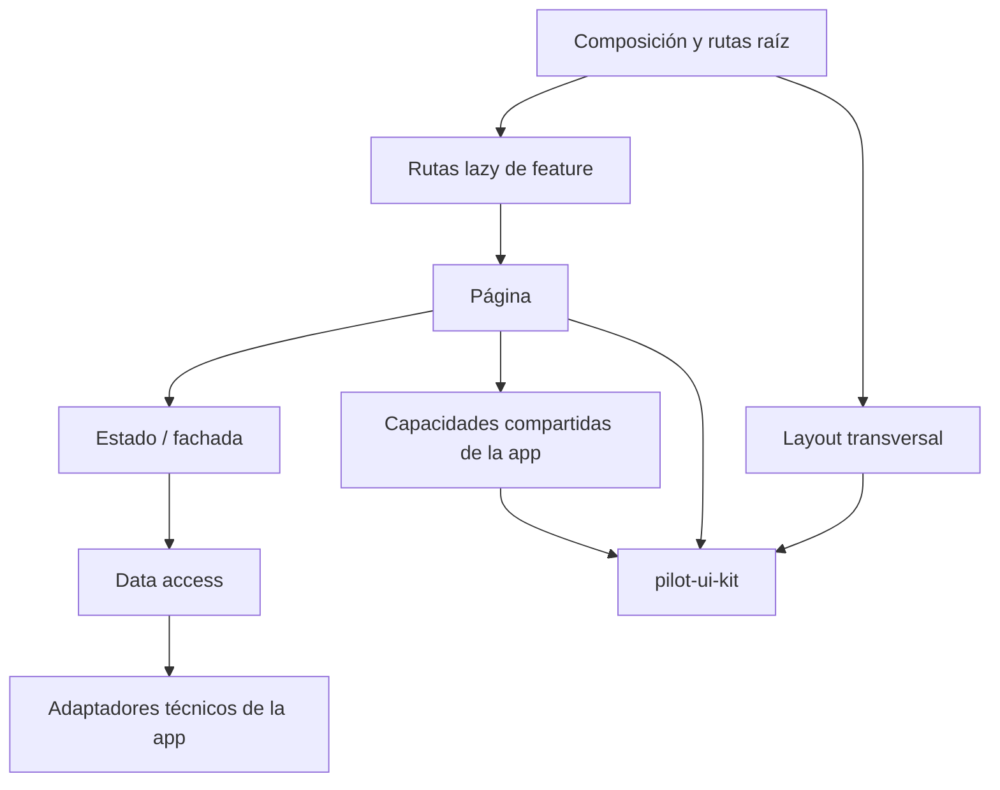

# Arquitectura frontend de CasePilot

- Estado: base Angular, kit, validadores e integración mínima de autenticación/perfil implementados; despliegue remoto pendiente.
- Fecha: 2026-10-04.
- Revisión: 2026-11-20.
- Normativa: [reglas FRT](frontend-architecture-rules.md).
- Decisiones: [ADR 0020](../adr/0020-frontend-foundation-and-theming.md) y [ADR 0022](../adr/0022-firebase-authentication-and-application-authorization.md).

La SPA pertenece a `src/apps/casepilot/casepilot-web/`; el kit visual reusable a `src/libs/frontend/pilot-ui-kit/`. Angular 21 es la rama LTS más reciente verificada el 2026-10-04; framework, CLI, Material y herramientas mantienen revisiones exactas compatibles en manifests/lockfile. La SPA es cliente estático, sin SSR ni despliegue remoto en esta etapa, e integra Firebase Authentication y perfil mínimo contra la API según [ADR 0022](../adr/0022-firebase-authentication-and-application-authorization.md).

## Organización por responsabilidad

```text
casepilot-web/
├── src/
│   ├── app/                # bootstrap, providers y rutas raíz
│   ├── shell/              # layout y navegación transversal
│   ├── features/
│   │   └── auth/
│   │       ├── auth.routes.ts
│   │       └── pages/login/ # placeholder inicial
│   ├── theme/              # nombres de recursos y manifiestos de temas
│   ├── main.ts
│   └── styles.css
├── public/themes/          # archivos instalados por la app
├── test/                   # unitarias y e2e de la SPA
└── angular.json / package.json / tsconfig*.json

pilot-ui-kit/
├── src/
│   ├── components/         # UI general sobre Material y renderer de recursos
│   ├── theme/              # contratos, tokens, registro, servicio y host DOM
│   ├── styles/             # roles Material y puente semántico Tailwind
│   └── public-api.ts
└── test/                   # comportamiento del kit
```

Cuando exista contenido, cada feature podrá agregar `components/`, `state/`, `data-access/` y `models/`. `state/` orquesta interacción de UI; `data-access/` encapsula clientes/mappers y depende de modelos, no de páginas. Las reglas de negocio y autorización permanecen en backend; no se duplica el dominio de NestJS.

Las capacidades usadas por varias features de la app se agrupan en `core/<capability>/` (auth control, clientes técnicos, configuración o adaptadores) y `shared/<capability>/` (mensajes, notificaciones y UI específica transversal). No son librerías públicas ni dependen de features. Solo se crean carpetas cuando exista implementación. La biblioteca `pilot-ui-kit` conserva únicamente capacidades visuales generales con consumidores actuales/planificados.



## Temas y recursos

El kit publica un contrato de roles de color, nombres CSS y referencias TypeScript. La paleta base es un único conjunto de datos; los componentes solo usan referencias semánticas. El servicio aplica los roles a `document.documentElement` mediante un host inyectable, para que el overlay de Material reciba el mismo tema. Material y Tailwind traducen sus roles a esas variables; las paletas Tailwind predeterminadas se eliminan.

La aplicación registra temas y nombres de recursos. Una variante puede sobrescribir colores y recursos, manteniendo el fallback de recursos del tema inicial. Cambiar de tema no cambia imports ni referencias de los consumidores: un logo sigue siendo `brand.logo`, aunque su archivo pertenezca a Christmas. Los temas se cambian desde composición/servicio, sin añadir controles al login placeholder.

El renderer acepta imágenes, iconos SVG, GIFs/animaciones de imagen y vídeos. Las imágenes animadas declaran un recurso estático para reduced motion; los vídeos tienen controles y no autoplay. Otros formatos, como Lottie, requieren un renderer/adaptador explícito antes de usarse. No se descarga ni inserta SVG remoto como HTML y no se omite sanitización.

## Validación y límites

El gate combina compilación Angular estricta, ESLint TypeScript/templates, grafo dependency-cruiser y análisis de estructura/templates/estilos. La [cobertura ejecutable](../../tools/frontend-architecture/README.md) identifica cada FRT, checker y regresión. Las pruebas del kit acreditan cambios de colores/recursos y fallback; las e2e de la SPA acreditan rutas, viewport y accesibilidad del placeholder.

Las reglas de imports no prueban permisos ni secretos, y los análisis de estilo no comprueban los colores de imágenes binarias. El gate frontend no certifica Firebase, Cloud Run, Hosting, Neon ni Cloud SQL: esas integraciones siguen pendientes conforme al [documento de infraestructura](infrastructure-providers.md).

El [workflow de calidad frontend](../../.github/workflows/frontend-quality.yml) está definido y usa `pnpm check:web`; no despliega ni requiere credenciales de proveedores. Su ejecución en GitHub y la protección de ramas aún deben verificarse/configurarse cuando se incorpore al remoto. Los checks locales no configuran esas protecciones.

## Referencias verificadas el 2026-10-04

- [Soporte y versiones Angular](https://angular.dev/reference/releases) y [compatibilidad](https://angular.dev/reference/versions).
- [Guía de estilo Angular](https://angular.dev/style-guide).
- [Temas Angular Material 21](https://v21.material.angular.dev/guide/theming).
- [Tailwind con Angular](https://tailwindcss.com/docs/installation/framework-guides/angular).
