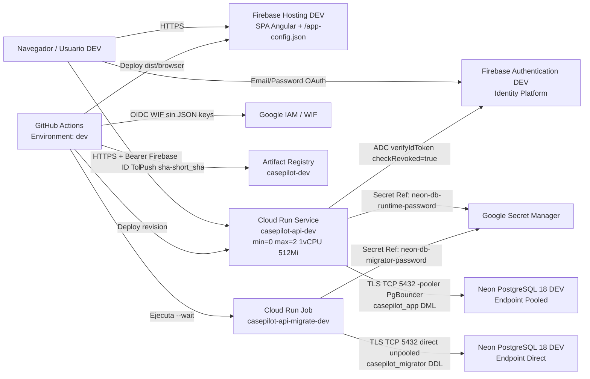

# Operación, IaC y CI/CD del ambiente DEV (GCP + Neon PostgreSQL)

- Estado: código IaC, Dockerfile, scripts CI/CD y workflows implementados y validados localmente; pendiente ejecución del bootstrap único remoto con credenciales del operador.
- Fecha: 2026-11-24.
- Decisiones canónicas: [ADR 0018](../adr/0018-infrastructure-providers-and-environments.md), [ADR 0021](../adr/0021-gcp-absolute-dev-infrastructure.md), [ADR 0022](../adr/0022-firebase-authentication-and-application-authorization.md) e [Infraestructura, proveedores y ambientes](../architecture/infrastructure-providers.md).

Este documento describe cómo se integran, comunican y configuran todas las piezas del ambiente remoto `development` (DEV), qué automatiza cada workflow y qué pasos únicos ejecuta el operador para levantar DEV por primera vez.

---

## 1. Arquitectura de componentes DEV y comunicación

### Cómo se comunican y configuran las piezas

1. **SPA (`casepilot-web`) en Firebase Hosting DEV**:
   - `deploy-dev.yml` compila Angular (`dist/browser/`), genera `/app-config.json` con [`tools/ci/generate-web-app-config.mjs`](../../tools/ci/generate-web-app-config.mjs) usando solo variables públicas (`environment: "development"`, `apiBaseUrl` de Cloud Run, `firebase.{apiKey,authDomain,projectId,appId}`, `authEmulatorUrl: null`) y publica usando [`deploy/dev/firebase.json`](../../deploy/dev/firebase.json).
   - `deploy/dev/firebase.json` configura rewrites SPA (`** -> /index.html`), headers de seguridad (`nosniff`, `DENY`, `HSTS`, `Referrer-Policy`, `Permissions-Policy`), caché inmutable para assets con hash y `Cache-Control: no-store` para `/app-config.json`.
   - En runtime, la SPA lee `/app-config.json` al arrancar, inicia sesión en Firebase Authentication DEV y adjunta el Firebase ID Token como `Authorization: Bearer <token>` hacia Cloud Run.
2. **API (`casepilot-api`) en Cloud Run Service (`casepilot-api-dev`)**:
   - Corre la imagen inmutable construida con [`infra/docker/casepilot-api.Dockerfile`](../../infra/docker/casepilot-api.Dockerfile) como usuario no-root `node` en el puerto `8080` (`PORT` inyectado por Cloud Run, con `API_PORT` como override de mayor prioridad).
   - Recibe `APP_ENV=development`, `CORS_ORIGINS` restringido a los orígenes HTTPS de Firebase Hosting DEV, `AUTH_FIREBASE_PROJECT_ID` del proyecto GCP DEV, y los campos discretos de Neon (`DATABASE_HOST` = host **pooled**, `DATABASE_USER=casepilot_app`, `DATABASE_SSL=true`, `DATABASE_STATEMENT_TIMEOUT_ENABLED=false` para compatibilidad con PgBouncer en modo transacción, `DATABASE_CONNECT_TIMEOUT_MS=15000`, `DATABASE_QUERY_TIMEOUT_MS=15000`, `DATABASE_POOL_SIZE=5`).
   - La contraseña `DATABASE_PASSWORD` se inyecta directamente desde Google Secret Manager (`neon-db-runtime-password:latest`) usando `sa-api-runtime-dev`.
   - Para verificar tokens Firebase con detección de revocación (`verifyIdToken(token, true)`), `sa-api-runtime-dev` posee `roles/firebaseauth.viewer` vía Application Default Credentials (sin archivo JSON).
3. **Migraciones coordinadas en Cloud Run Job (`casepilot-api-migrate-dev`)**:
   - Reutiliza **exactamente el mismo digest inmutable** de la imagen Docker de la API, sobrescribiendo el comando a `node ./node_modules/typeorm/cli.js migration:run -d dist/infrastructure/database/data-source.js`.
   - Se ejecuta como `sa-api-migrator-dev` con acceso exclusivo a `neon-db-migrator-password:latest` (`casepilot_migrator`, rol DDL) contra el host **direct / unpooled** de Neon (`DATABASE_STATEMENT_TIMEOUT_ENABLED=true`, `DATABASE_CONNECT_TIMEOUT_MS=30000`, `DATABASE_QUERY_TIMEOUT_MS=60000`).
   - Cumple `BCK-017`: `synchronize: false` y `migrationsRun: false` en runtime; si el Job falla, el pipeline aborta antes de tocar Cloud Run Service o Firebase Hosting.
4. **Aislamiento de identidades e IAM**:
   - `sa-terraform-dev`: provisiona IaC en GCP vía OIDC desde `infra-plan.yml` / `infra-apply-dev.yml`.
   - `sa-deployer-dev`: sube imágenes a Artifact Registry, ejecuta migraciones, actualiza Cloud Run Service y publica en Firebase Hosting vía OIDC desde `deploy-dev.yml`, limitado estrictamente al repositorio GitHub + `environment == 'dev'`. Solo puede hacer `iam.serviceAccountUser` sobre `sa-api-runtime-dev` y `sa-api-migrator-dev`.
   - `sa-api-runtime-dev`: accede únicamente al secreto `neon-db-runtime-password`, escribe logs y lee estado de revocación en Firebase Auth (`roles/firebaseauth.viewer`).
   - `sa-api-migrator-dev`: accede únicamente al secreto `neon-db-migrator-password` y escribe logs.

---

## 2. Catálogo de workflows CI/CD (`.github/workflows/`)

| Workflow | Disparador | Autenticación | Qué hace |
| --- | --- | --- | --- |
| [`backend-quality.yml`](../../.github/workflows/backend-quality.yml) | `pull_request`, `push`, `workflow_dispatch`, `workflow_call` | Sin credenciales cloud | Ejecuta `pnpm check:backend`, `pnpm test:ci-scripts` y `pnpm check:backend:integration` (Testcontainers PostgreSQL efímero). |
| [`frontend-quality.yml`](../../.github/workflows/frontend-quality.yml) | `pull_request`, `push`, `workflow_dispatch`, `workflow_call` | Sin credenciales cloud | Ejecuta `pnpm check:web` (UI kit, reglas FRT, regresiones, unitarias, build y Playwright + axe). |
| [`infra-plan.yml`](../../.github/workflows/infra-plan.yml) | `pull_request` hacia `development` sobre `infra/terraform/**`, `workflow_dispatch` | OIDC opcional en `plan-dev` | Ejecuta `terraform fmt -check`, `validate` y `tflint` siempre; si el environment `dev` ya tiene OIDC configurado, ejecuta `terraform plan` de solo lectura. |
| [`infra-apply-dev.yml`](../../.github/workflows/infra-apply-dev.yml) | `push` / merge a `development` sobre `infra/terraform/**`, `workflow_dispatch` | OIDC (`sa-terraform-dev`) | Valida formato/sintaxis y aplica Terraform DEV contra el estado remoto GCS con concurrencia exclusiva (`cancel-in-progress: false`). |
| [`deploy-dev.yml`](../../.github/workflows/deploy-dev.yml) | `push` / merge a `development` (ignorando docs), `workflow_dispatch` | OIDC (`sa-deployer-dev`) | 1) Quality gate (`backend-quality` + `frontend-quality`) → 2) Build & push imagen inmutable `sha-<short_sha>` → 3) Cloud Run Job de migraciones (`--wait`) → 4) Deploy Cloud Run Service + `smoke-test-api.mjs` (rollback automático a revisión previa si falla) → 5) Build SPA + `/app-config.json` + deploy Firebase Hosting + `smoke-test-web.mjs`. |

---

## 3. Bootstrap único y configuración inicial

El aprovisionamiento remoto inicial (creación del proyecto GCP `casepilot-dev`, proyecto Neon Free Tier + roles `casepilot_app`/`casepilot_migrator`, bucket GCS de estado, WIF OIDC, carga de secretos en Secret Manager y alta de `vars` en GitHub Environment `dev`) está documentado paso a paso en:

- [`infra/terraform/bootstrap/README.md`](../../infra/terraform/bootstrap/README.md)
- [`infra/terraform/bootstrap/bootstrap-gcp.sh`](../../infra/terraform/bootstrap/bootstrap-gcp.sh)
- [`infra/terraform/bootstrap/neon-dev-roles.sql`](../../infra/terraform/bootstrap/neon-dev-roles.sql)
